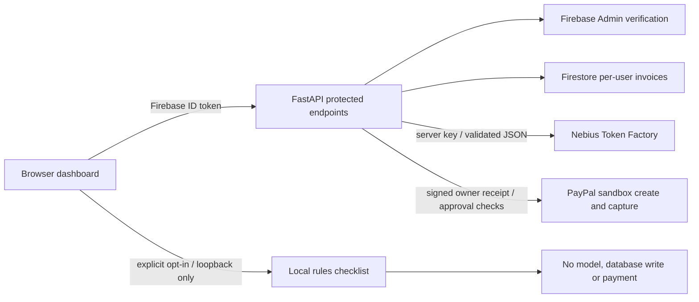

# PazaLink review demo validation — 24 October 2026

## Scope and evidence

The local application supports fictional invoice selection, filtering and a clearly labeled rules-only review without external credentials. It is an interface demonstration, not evidence of Nebius inference, PayPal payment, customer adoption or deployed service availability.

Automated validation: `python -m pytest -q` passed 54 tests before packaging. Provider responses are mocked with HTTPX; the Firebase store tests use test doubles. These tests do not verify any live provider. One Starlette warning concerns the deprecated HTTPX TestClient integration. The payment tests cover valid capture, cross-user rejection, receipt tampering and expiry, approval status, changed reference/amount/currency, pending capture, processor errors, completed-order reconciliation and idempotency scope.

Manual browser validation on `http://127.0.0.1:8789/`: page loaded without Firebase credentials; local rules flagged the selected fictional record's changed payment instructions. Earlier testing on port 8788 verified searching for Kijiji filtered the sample table. Protected review and invoice endpoints still require Firebase authentication. No payment or model call was made. Payment approval and capture UI need a real authenticated sandbox run.

## Architecture

## Competition requirements and outstanding blockers

* Nebius × NVIDIA: [official rules](https://nebiusglobalaihackathon.devpost.com/rules), deadline 30 October 2026 at 10:00 PDT (20:00 Nairobi). Requires actual Nebius runtime plus NVIDIA open-source model, public licensed repository, working demo/test build, and public YouTube walkthrough under three minutes. A rules-only recording cannot establish eligibility.
* PayPal AI: [official rules](https://paypalaihackathon.devpost.com/rules), deadline 12 November 2026 at 12:00 PST (23:00 Nairobi). Requires meaningful PayPal sandbox functionality and AI, public licensed source and runnable instructions or a hosted demo, with public YouTube video under three minutes.

Nebius registration is complete. A $25 Token Factory promo code arrived by email on 24 October. It has not been redeemed: the console blocks access behind billing details and a card, and the newer [official billing documentation](https://docs.tokenfactory.nebius.com/other-capabilities/billing-new) confirms mandatory card onboarding and potential automatic charges. Neither billing details nor a card was supplied. No API key or model call has been verified. Older documentation describing a card-free promo flow does not match this account's current screen.

Firebase sign-in and Firestore need genuine project configuration and a controlled test identity. PayPal sandbox credentials and a signing secret are not configured. Ownership-bound capture and buyer-approval checks are now implemented and mock-tested, but genuine buyer approval and processor capture remain unverified. No hosted demo URL or final competition walkthrough is claimed. The local server is not an externally reachable demo URL.

## Next live validation

1. Verify free credits and obtain an approved server-side Nebius credential without enabling paid usage.
2. Configure the existing Firebase architecture; verify two-user isolation using real test identities.
3. Run an actual NVIDIA model request and retain a redacted provider request ID and model name.
4. Exercise the implemented PayPal sandbox approval/capture with real sandbox buyer/seller accounts and verify the processor result; never treat a manual invoice status as payment proof.
5. Record a continuous live walkthrough under three minutes once the required integrations work. Keep credential and billing screens out of the recording.
6. Recheck the official rules, repository license/access and evidence before seeking submission approval.
