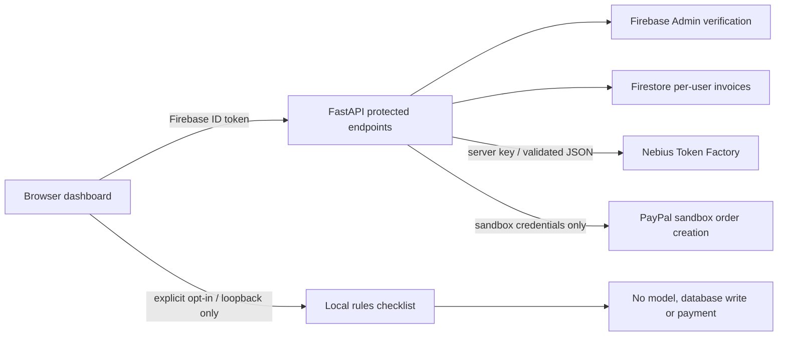

# PazaLink review demo validation — 24 October 2026

## Scope and evidence

The local application supports fictional invoice selection, filtering and a clearly labeled rules-only review without external credentials. It is an interface demonstration, not evidence of Nebius inference, PayPal payment, customer adoption or deployed service availability.

Automated validation: `python -m pytest -q` passed 32 tests before packaging. Provider responses are mocked with HTTPX; the Firebase store tests use test doubles. These tests do not verify any live provider. One Starlette warning concerns the deprecated HTTPX TestClient integration.

Manual browser validation on `http://127.0.0.1:8788/`: page loaded without Firebase credentials; the local rules button returned a checklist; searching for Kijiji filtered the sample table. Protected review and invoice endpoints still require Firebase authentication. No payment or model call was made.

## Architecture

## Competition requirements and outstanding blockers

* Nebius × NVIDIA: [official rules](https://nebiusglobalaihackathon.devpost.com/rules), deadline 30 October 2026 at 10:00 PDT (20:00 Nairobi). Requires actual Nebius runtime plus NVIDIA open-source model, public licensed repository, working demo/test build, and public YouTube walkthrough under three minutes. A rules-only recording cannot establish eligibility.
* PayPal AI: [official rules](https://paypalaihackathon.devpost.com/rules), deadline 12 November 2026 at 12:00 PST (23:00 Nairobi). Requires meaningful PayPal sandbox functionality and AI, public licensed source and runnable instructions or a hosted demo, with public YouTube video under three minutes.

Nebius registration is complete. The console requests billing details and a card; neither was supplied. The official hackathon free-credit request returned “Form submitted — The promo code will be emailed to you.” Credits have not yet been verified or redeemed. No API key or model call has been verified.

Firebase sign-in and Firestore need genuine project configuration and a controlled test identity. PayPal credentials, buyer approval and ownership-bound capture remain outstanding. Capture deliberately returns 501 when enabled, pending those checks. No hosted demo URL or final competition walkthrough is claimed. The local server is not an externally reachable demo URL.

## Next live validation

1. Verify free credits and obtain an approved server-side Nebius credential without enabling paid usage.
2. Configure the existing Firebase architecture; verify two-user isolation using real test identities.
3. Run an actual NVIDIA model request and retain a redacted provider request ID and model name.
4. Implement ownership-bound PayPal sandbox approval/capture and verify the processor result; never treat a manual invoice status as payment proof.
5. Record a continuous live walkthrough under three minutes once the required integrations work. Keep credential and billing screens out of the recording.
6. Recheck the official rules, repository license/access and evidence before seeking submission approval.
